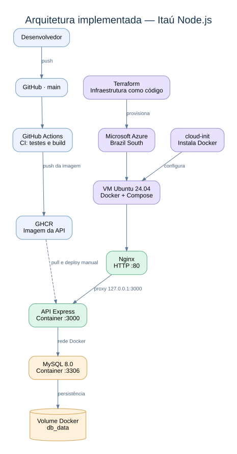

# Itaú — Infraestrutura, Containerização e CI

> Aplicação Node.js/Express implantada em uma máquina virtual Microsoft Azure, com infraestrutura declarativa em Terraform, configuração inicial automatizada via cloud-init, containers Docker, banco MySQL persistente e exposição HTTP por Nginx.

## Visão geral

O projeto utiliza uma API Node.js/Express conectada a um banco MySQL 8.0. A infraestrutura de hospedagem foi provisionada na Microsoft Azure por meio do Terraform. A VM Ubuntu 24.04 recebe o Docker e o Docker Compose durante sua inicialização, por meio de um arquivo `cloud-init.yaml`.

A imagem da aplicação é construída e publicada no GitHub Container Registry (GHCR) por um workflow de integração contínua (CI) no GitHub Actions. Na VM, o Docker Compose executa a API e o MySQL; o Nginx funciona como proxy reverso para disponibilizar a API pela porta HTTP 80.

**Escopo efetivamente implementado:** provisionamento da infraestrutura, instalação automatizada das ferramentas na VM, publicação da imagem no GHCR, implantação da aplicação por Docker Compose, persistência do MySQL e acesso HTTP público. A atualização da aplicação na VM é realizada manualmente após a publicação de uma nova imagem.

## Arquitetura da infraestrutura



### Componentes

| Camada                     | Tecnologia                           | Papel no projeto                                       |
| -------------------------- | ------------------------------------ | ------------------------------------------------------ |
| Infraestrutura como código | Terraform + AzureRM                  | Define e gerencia os recursos Azure                    |
| Computação                 | Azure Virtual Machine / Ubuntu 24.04 | Hospeda os serviços                                    |
| Rede                       | VNet, subnet, IP público, NIC e NSG  | Conectividade e regras de entrada                      |
| Inicialização              | cloud-init                           | Instala Docker/Compose, prepara diretório e permissões |
| Containerização            | Docker                               | Executa a API e o banco de dados                       |
| Orquestração local         | Docker Compose                       | Define serviços, dependências, rede e volume           |
| Aplicação                  | Node.js / Express                    | Disponibiliza os endpoints HTTP                        |
| Banco de dados             | MySQL 8.0                            | Armazena dados da aplicação                            |
| Proxy reverso              | Nginx                                | Encaminha HTTP/80 para a API em 127.0.0.1:3000         |
| Integração contínua        | GitHub Actions                       | Executa verificações, testes, build e publicação       |
| Registry                   | GHCR                                 | Armazena a imagem versionada da API                    |

## Infraestrutura Azure com Terraform

Os recursos foram criados na região `brazilsouth`, dentro do Resource Group `rg-itau-demo`:

| Recurso Terraform                                           | Nome no Azure      | Finalidade                                    |
| ----------------------------------------------------------- | ------------------ | --------------------------------------------- |
| `azurerm_resource_group.itau`                               | `rg-itau-demo`     | Agrupar os recursos                           |
| `azurerm_virtual_network.itau`                              | `vnet-itau`        | Rede virtual `10.0.0.0/16`                    |
| `azurerm_subnet.itau`                                       | `subnet-itau`      | Sub-rede `10.0.1.0/24`                        |
| `azurerm_public_ip.itau`                                    | `ip-itau`          | Endereço público estático, SKU Standard       |
| `azurerm_network_security_group.itau`                       | `nsg-itau`         | Controlar tráfego de entrada                  |
| `azurerm_network_interface.itau`                            | `nic-itau`         | Interface de rede da VM                       |
| `azurerm_network_interface_security_group_association.itau` | Associação NIC/NSG | Aplicar as regras de segurança à interface    |
| `azurerm_linux_virtual_machine.itau`                        | `vm-itau-demo`     | Servidor Ubuntu 24.04, SKU `Standard_D2as_v4` |

O NSG possui regras para SSH na porta 22 com origem restrita ao endereço autorizado e regras HTTP/HTTPS nas portas 80 e 443. O Nginx atende requisições HTTP na porta 80; a existência de uma regra de rede para 443 **não** representa habilitação de HTTPS.

### Organização do código de infraestrutura

Os arquivos de infraestrutura utilizados são:

```text
terraform/
├── main.tf
├── variables.tf
├── terraform.tfvars
└── cloud-init.yaml
```

- `main.tf`: provedor AzureRM e recursos de rede e computação.
- `variables.tf`: parâmetros da assinatura, região, chave pública SSH e CIDR autorizado.
- `terraform.tfvars`: valores locais usados no provisionamento.
- `cloud-init.yaml`: configuração automatizada da VM durante a primeira inicialização.

### Provisionamento

Os comandos Terraform executados a partir do diretório `terraform/` são:

```bash
terraform init
terraform validate
terraform plan
terraform apply
```

O `terraform plan` permite inspecionar os recursos e alterações previstos antes de aplicá-los. Os arquivos de estado e de variáveis que contenham informações sensíveis não devem ser versionados no repositório.

**Registro de implantação:** durante o provisionamento foram encontrados problemas de disponibilidade de SKU na região e inconsistências de leitura do recurso de IP público pelo provedor. A infraestrutura foi reconciliada com o Terraform State, e a criação final dos recursos pendentes foi realizada utilizando um plano salvo. O resultado foi a criação da VM e de sua interface de rede, posteriormente verificadas por SSH.

## Bootstrap da VM com cloud-init

A VM recebe `custom_data` a partir do arquivo `cloud-init.yaml`. A configuração realiza:

1. Atualização de pacotes.
2. Instalação de dependências de sistema e dos pacotes Docker e Docker Compose.
3. Habilitação do serviço Docker.
4. Criação do diretório `/opt/itau-node`.
5. Ajuste de propriedade e permissão do diretório para o usuário `azureuser`.
6. Inclusão do usuário no grupo `docker`.

A configuração foi validada no servidor:

```bash
docker --version
docker compose version
sudo systemctl status docker
docker ps
```

O serviço Docker foi observado em estado `active (running)` e habilitado para inicialização automática.

## Containerização e persistência

O `Dockerfile` da API usa a imagem base `node:24`, instala as dependências com `npm ci`, copia os arquivos da aplicação, executa `npm run build`, expõe a porta `3000` e inicia o processo com `node src/server.js`.

Na VM, o Docker Compose coordena dois serviços:

**`app` — API Node.js/Express**

- Utiliza a imagem publicada em `ghcr.io/victorbrit1/itau-desafio-node.js:latest`.
- Usa as variáveis `DB_HOST`, `DB_USER`, `DB_PASSWORD`, `DB_NAME` e `DB_PORT` para acessar o banco.
- Aguarda o serviço MySQL atingir o estado saudável antes da inicialização, via `depends_on` com `service_healthy`.
- Publica a porta como `127.0.0.1:3000:3000`, evitando exposição direta da porta 3000 à internet.
- Usa a política de reinício `unless-stopped`.

**`db` — MySQL 8.0**

- Utiliza a imagem `mysql:8.0`.
- Recebe a configuração do banco e da senha por variáveis de ambiente.
- Possui `healthcheck` com `mysqladmin ping`.
- Persiste os dados no volume nomeado `db_data`, montado em `/var/lib/mysql`.
- Não publica a porta 3306 no host; a conexão com a API acontece pela rede do Compose.
- Usa a política de reinício `unless-stopped`.

### Comandos operacionais

Na VM:

```bash
cd /opt/itau-node

docker compose ps
docker compose logs --tail=50 app
docker compose logs --tail=50 db
```

Para atualizar manualmente a API depois que uma nova imagem for publicada no GHCR:

```bash
cd /opt/itau-node
docker compose pull app
docker compose up -d --no-deps app
```

O argumento `--no-deps app` mantém o banco fora do processo de recriação do serviço de aplicação. O volume do MySQL permanece independente do ciclo de vida do container.

## Publicação HTTP com Nginx

O Nginx está instalado diretamente no Ubuntu e atua como proxy reverso. O fluxo de uma chamada HTTP é:

```text
Cliente HTTP
    ↓
IP público da Azure, porta 80
    ↓
Nginx no host
    ↓
http://127.0.0.1:3000
    ↓
API Express no container
```

O servidor Nginx encaminha as requisições com `proxy_pass` e repassa cabeçalhos como `Host`, `X-Real-IP`, `X-Forwarded-For` e `X-Forwarded-Proto`.

A configuração foi testada localmente e por acesso externo. A rota principal respondeu com **HTTP 200** e:

```json
{
  "status": "UP",
  "message": "API funcionando"
}
```

A URL pública observada durante a implantação foi `http://20.226.83.186`. A disponibilidade do endereço depende da VM e da infraestrutura Azure estarem ativas.

> **Nota de segurança:** o acesso público validado utiliza HTTP, sem criptografia TLS. Não devem ser transmitidos dados sensíveis por esse endpoint.

## Integração contínua com GitHub Actions

O workflow de CI é acionado em eventos de `push` para a branch `main`. O pipeline implementado possui as seguintes etapas:

1. **Checkout:** baixa o código do repositório com `actions/checkout@v4`.
2. **Cache:** reutiliza o cache npm para dependências.
3. **Instalação:** executa `npm ci`.
4. **Auditoria:** executa `npm audit --audit-level=high`.
5. **Testes:** executa `npm test`.
6. **Build:** executa `npm run build`.
7. **Autenticação no GHCR:** usa `docker/login-action@v3` com `GITHUB_TOKEN`.
8. **Build Docker:** gera a imagem da aplicação.
9. **Publicação:** envia a imagem ao GHCR com duas tags: SHA do commit e `latest`.

O workflow tem permissões `contents: read` e `packages: write`, suficientes para ler o repositório e publicar imagens do pacote usando `GITHUB_TOKEN`. Também define um grupo de concorrência para evitar sobreposição indesejada de execuções do mesmo ref.

### Estratégia de tags

```text
ghcr.io/victorbrit1/itau-desafio-node.js:<SHA_DO_COMMIT>
ghcr.io/victorbrit1/itau-desafio-node.js:latest
```

A tag de commit identifica o artefato correspondente a uma revisão específica do código. A tag `latest` é a referência utilizada no Compose da VM.

### Limite atual da automação

O CI **publica automaticamente** novas imagens, mas **não realiza a atualização automática da aplicação na VM**. Após o sucesso do workflow, o operador acessa a VM via SSH e executa os comandos de atualização do Compose apresentados acima.

## Verificações realizadas

A implantação foi conferida por comandos e respostas reais no ambiente:

| Validação          | Evidência observada                                        |
| ------------------ | ---------------------------------------------------------- |
| VM provisionada    | `azurerm_linux_virtual_machine.itau` concluído com sucesso |
| Acesso à VM        | Conexão SSH com o usuário `azureuser`                      |
| Docker instalado   | `docker --version` retornou versão 29.1.3                  |
| Compose instalado  | `docker compose version` retornou versão 2.40.3            |
| Docker ativo       | `systemctl` indicou `active (running)`                     |
| API em execução    | `docker compose ps` indicou container `itau_app` ativo     |
| Banco disponível   | `docker compose ps` indicou `itau_db` como `healthy`       |
| Endpoint da API    | `curl -i http://localhost:3000` retornou `HTTP/1.1 200 OK` |
| Publicação externa | Requisição pelo IP público via Nginx funcionou             |

O status `healthy` do MySQL confirma a verificação de saúde configurada para o serviço. Ele não substitui um teste funcional de leitura e escrita de dados pela API.

## Operação da VM

O ambiente Azure é independente do computador do desenvolvedor: fechar o terminal SSH ou desligar o PC local não encerra a VM.

Para consultar os serviços após acessar a VM:

```bash
sudo systemctl status docker
sudo systemctl status nginx
cd /opt/itau-node
docker compose ps
curl -i http://127.0.0.1:3000/
curl -i http://localhost/
```

O Compose usa `restart: unless-stopped` para a API e o MySQL. Em uma reinicialização normal, isso permite que os containers sejam iniciados novamente pelo Docker, salvo situações como parada manual ou falhas persistentes da aplicação.

A infraestrutura pode ser inspecionada usando `terraform plan` e `terraform state list`. Mudanças fora do Terraform podem causar divergências com o State; antes de aplicar novos planos, é necessário avaliar o que foi alterado na Azure.

## Boas práticas aplicadas ao ambiente

- **Infraestrutura declarativa:** recursos de Azure descritos em arquivos Terraform.
- **Provisionamento reproduzível:** instalação inicial da VM definida por cloud-init.
- **Separação de responsabilidades:** Nginx no host, API e MySQL em containers distintos.
- **Persistência de dados:** volume nomeado para o diretório do MySQL.
- **Restrição de superfície de exposição:** MySQL sem porta publicada; API limitada ao loopback; SSH restrito por origem no NSG.
- **Imagem versionada:** publicação no GHCR com SHA do commit além de `latest`.
- **Validação automatizada do código:** instalação, auditoria, testes e build no GitHub Actions.
- **Configuração sensível separada:** senha do banco e referências de imagem definidas no `.env` da VM, sem valores concretos na documentação.

---

**Projeto:** `victorbrit1/itau-desafio-node.js`  
**Stack de infraestrutura:** Azure · Terraform · cloud-init · Ubuntu · Docker · Docker Compose · MySQL · Nginx · GitHub Actions · GHCR
